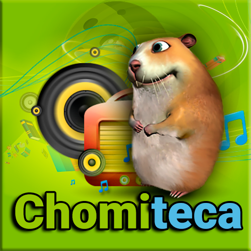

# Chomiteca

  

  
  

A Kodi video/audio add-on for browsing, streaming, and managing content from Chomikuj.pl.

Personal fork of [plugin.video.chomiteca](https://github.com/Leinad4Mind/Leinad4Mind-Kodi-Addons-Repo/tree/master/plugin.video.chomiteca) by Leinad4Mind, focusing on critical bug fixes, robustness improvements, data loss prevention, and modern Kodi 21 (Omega) compatibility. **It is not an official release** and is not affiliated with or endorsed by the original author or Chomikuj.pl.

## Features

- **Chomikuj.pl Browsing & Streaming**: Browse personal accounts, public folders, and play supported video and audio files directly in Kodi.
- **Kodi Library Integration**: Generate `.strm` files and metadata (`.nfo`) to integrate remote files seamlessly into your Kodi library.
- **Background Downloads**: Built-in queue manager for downloading media files with resume capability.
- **Search & Local Indexing**: Search for files and accounts, with optimized caching for responsive lookups.
- **Subtitle Integration**: Automatic and manual subtitle matching.

## Compatibility

- **Kodi**: Tested and supported on **Kodi 21 (Omega)** (Python 3).
- **Platforms**: Cross-platform (Windows, Linux, Android, macOS).

## Security & Authentication

By default, Chomiteca stores your Chomikuj password in plain text in `accounts.json` inside your Kodi user profile. If you prefer not to store your password on disk, disable **Settings → General → Store password** and authenticate by importing browser cookies instead:

1. **Paste method:** open Chomikuj in your browser, open DevTools → Network, copy the `Cookie` request header, paste it into Kodi.
2. **File method:** export cookies with a browser extension (e.g. "Get cookies.txt LOCALLY") and pick the `.txt` file from Kodi's file browser.

Imported cookies are stored in `cookies.lwp` (chmod 0600 on Linux/macOS) and verified on every session. Expired cookies trigger a "reimport cookies" notification.

## Releases

For release notes and pre-built add-on packages, visit the [Releases](https://github.com/johanst21/chomiteca/releases) page or see [CHANGELOG.md](CHANGELOG.md) for the full change history.

## Project status

Active development fork. 1.14.0 closes the pagination bug and adds an opt-in cookie authentication method.

## Disclaimer

This add-on accesses Chomikuj.pl through web scraping and public interfaces. There is no official relationship with Chomikuj.pl or Leinad4Mind. Use at your own discretion and responsibility.
